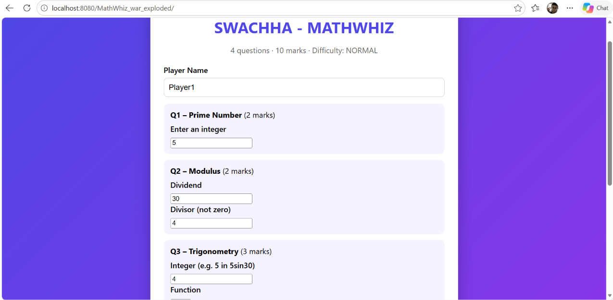
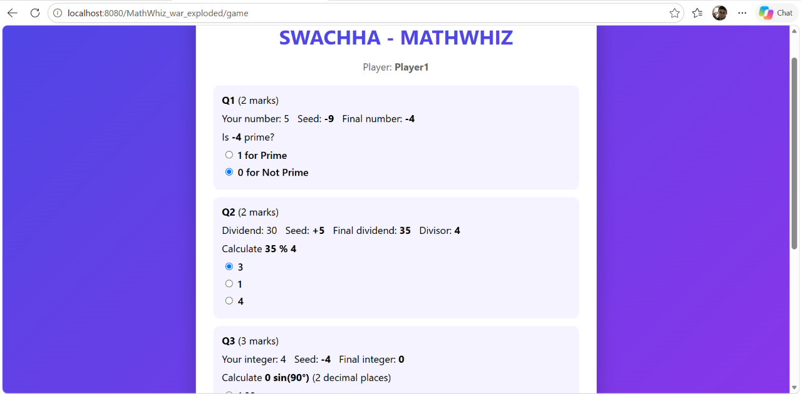
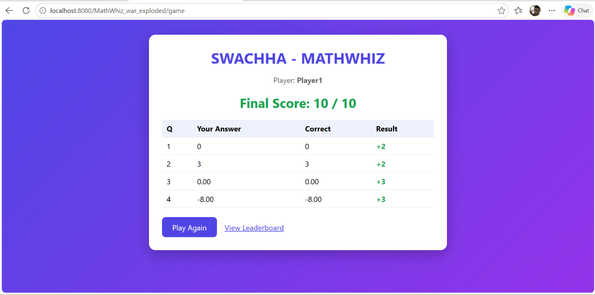
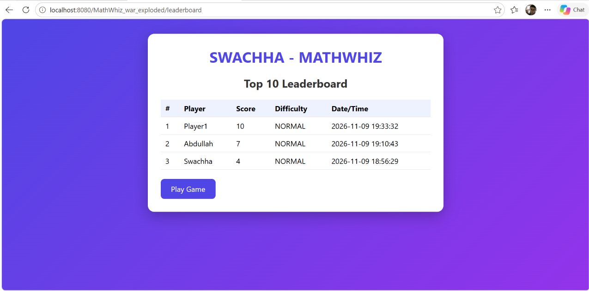

# SWACHHA - MATHWHIZ

A web-based mathematical game built with **Java Servlet/JSP, JDBC and MySQL**. The player answers four math questions (Prime, Modulus, 2 × Trigonometry), gets a score out of 10, and the result is saved in a database and shown on a Top 10 leaderboard.

## Project Objectives

- Build reusable Java methods for mathematical calculations.
- Process requests and responses using Java Servlets.
- Connect to a database with JDBC and `PreparedStatement`.
- Store, retrieve, sort and display records (Top 10 leaderboard).
- Document and submit a complete project on GitHub.

## Technologies Used

| Area | Technology |
|------|------------|
| Language | Java 17 |
| Web | Jakarta Servlet 6, JSP, JSTL |
| Server | Apache Tomcat 10.1 |
| Database | MySQL 8 + JDBC |
| Build | Maven |

## Software Requirements

- JDK 17 or later
- Apache Tomcat 10.1 or later
- MySQL 8 or later
- Maven 3.8 or later (or an IDE with Maven support)

## Database Configuration

Edit `src/main/resources/db.properties`:

```properties
db.url=jdbc:mysql://localhost:3306/math_whiz_db?useSSL=false&allowPublicKeyRetrieval=true&serverTimezone=UTC
db.user=root
db.password=YOUR_PASSWORD
```

## Steps to Run the Application

1. Run `database/math_whiz_db.sql` in MySQL.
2. Put your MySQL password in `src/main/resources/db.properties`.
3. Build the project:
   ```
   mvn clean package
   ```
4. Copy `target/MathWhiz.war` into Tomcat's `webapps/` folder and start Tomcat.
5. Open `http://localhost:8080/MathWhiz/` in a browser.

Run the math tests (no Maven needed):

```
javac -d out src/main/java/model/Question.java src/main/java/service/*.java src/test/java/service/MathServiceTest.java
java -cp out service.MathServiceTest
```

---

## Complete Java Source Code

```
MathWhiz/
├── src/main/java/
│   ├── controller/GameServlet.java     # request handling
│   ├── model/GameScore.java            # score record
│   ├── model/Question.java             # one game question
│   ├── service/MathService.java        # isPrime, calculateMod, calculateSin/Cos/Tan
│   ├── service/QuestionFactory.java    # seed, final value, options, answer checking
│   └── dao/
│       ├── DBUtil.java                 # JDBC connection
│       └── ScoreDAO.java               # INSERT / SELECT
├── src/main/resources/db.properties
├── src/main/webapp/
│   ├── index.jsp                       # welcome + inputs
│   ├── game.jsp                        # questions + options
│   ├── result.jsp                      # final score
│   ├── leaderboard.jsp                 # top 10
│   ├── css/style.css
│   └── WEB-INF/web.xml
├── src/test/java/service/MathServiceTest.java
├── database/math_whiz_db.sql
└── README.md
```

Math methods (in `MathService`):

```java
public static int isPrime(int number)
public static int calculateMod(int a, int b)
public static double calculateSin(double degree)
public static double calculateCos(double degree)
public static double calculateTan(double degree)
```

## Servlet Implementation

`GameServlet` is mapped to `/game` and `/leaderboard`.

| Request | Action |
|---------|--------|
| `POST /game` `action=start` | Validate inputs, apply seed, build 4 questions, forward to `game.jsp` |
| `POST /game` `action=submit` | Check answers with Java methods, calculate score, save to DB, forward to `result.jsp` |
| `GET /leaderboard` | Load top 10 from DB, forward to `leaderboard.jsp` |

## JDBC Database Connectivity

- `DBUtil` opens the connection using `db.properties`.
- `ScoreDAO.save()` uses a `PreparedStatement` to insert player name, score, difficulty and date/time.
- `ScoreDAO.getTop10()` retrieves records with `SELECT`.

## Database SQL File

File: `database/math_whiz_db.sql`

```sql
CREATE DATABASE IF NOT EXISTS math_whiz_db;
USE math_whiz_db;

CREATE TABLE IF NOT EXISTS game_scores (
    id INT AUTO_INCREMENT PRIMARY KEY,
    player_name VARCHAR(100) NOT NULL,
    score INT NOT NULL,
    difficulty VARCHAR(20) NOT NULL DEFAULT 'NORMAL',
    played_at TIMESTAMP NOT NULL DEFAULT CURRENT_TIMESTAMP
);
```

## Four-Question Mathematical Game

Each question: the player enters integer input, a random **seed (1–10)** is added or subtracted, the **final value** is shown, then the player selects an answer. The correct answer is always calculated by Java methods.

| Q | Area | Player input | Seed applied to | Options |
|---|------|--------------|-----------------|---------|
| 1 | Prime Number | one integer | the integer | `1` (Prime) / `0` (Not Prime) |
| 2 | Modulus | dividend, divisor (not 0) | the dividend | 3 options (1 correct) |
| 3 | Trigonometry | integer, sin/cos/tan, angle (e.g. `5 sin 30`) | the integer | 3 options (1 correct) |
| 4 | Trigonometry | same as Q3 | the integer | 3 options (1 correct) |

Rules:

- Prime: return `1` if prime, otherwise `0`. Numbers less than 2 are not prime.
- Modulus: integers only. The divisor must not be zero.
- Trigonometry: angles are in degrees, converted to radians, then `Math.sin()`, `Math.cos()`, `Math.tan()` are used. Undefined tan values (90°, 270°) are rejected.
- Decimal answers are compared with a tolerance of ±0.01.
- Difficulty: `NORMAL` (stored in the database).

## Score Calculation (10 Marks)

| Question | Marks |
|----------|-------|
| Q1 Prime | 2 |
| Q2 Modulus | 2 |
| Q3 Trigonometry | 3 |
| Q4 Trigonometry | 3 |
| **Total** | **10** |

```java
int totalScore = 0;
if (primeCorrect) totalScore += 2;
if (modCorrect)   totalScore += 2;
if (trig1Correct) totalScore += 3;
if (trig2Correct) totalScore += 3;
```

Correct answer = marks awarded. Incorrect answer = 0.

## Top 10 Leaderboard

Shows player name, score, difficulty and date/time. Highest score first; for equal scores, the earlier date/time ranks higher.

```sql
SELECT * FROM game_scores
ORDER BY score DESC, played_at ASC
LIMIT 10;
```

## Application Screenshots

### Welcome Page


### Game Page


### Result Page


### Leaderboard


## GitHub Repository Subdirectory URL

https://github.com/Swachha001/SWACHHA-MATHWHIZ

## Complete README

This README contains: project title and description, objectives, technologies, software requirements, database configuration, database creation SQL, steps to run, game rules and scoring, screenshots and the GitHub project directory link.

---

## GitHub Submission Checklist

- [x] [Complete Java source code](#complete-java-source-code)
- [x] [Servlet/Spring implementation](#servlet-implementation)
- [x] [JDBC database connectivity](#jdbc-database-connectivity)
- [x] [Database SQL file](#database-sql-file)
- [x] [Four-question mathematical game](#four-question-mathematical-game)
- [x] [Score calculation (10 marks)](#score-calculation-10-marks)
- [x] [Top 10 leaderboard](#top-10-leaderboard)
- [x] [Complete README.md](#complete-readme)
- [x] [Application screenshots](#application-screenshots)
- [x] [GitHub repository subdirectory URL](#github-repository-subdirectory-url)
